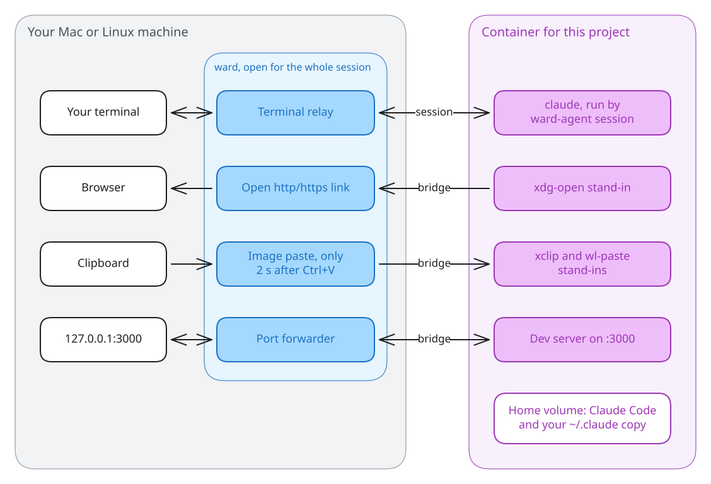
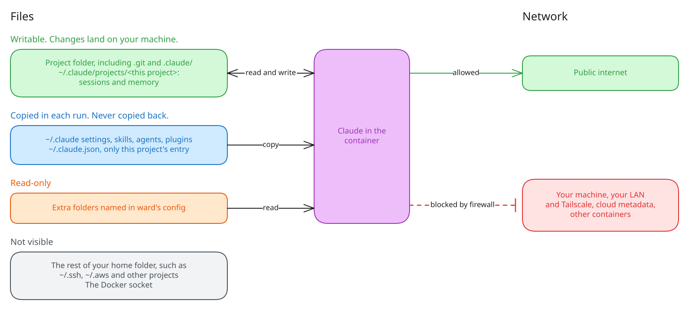

# ward

Run Claude Code with permission prompts off, inside a container that can only damage the project you are working in.

**Status: design phase. Nothing is built yet.** The design is in [docs/designs/ward.md](docs/designs/ward.md).

## How it works

You type `ward` in a project folder where you would have typed `claude`. ward starts a container for that folder and runs Claude inside it, connected to your terminal. ward stays open for the whole session. It is the only way the container can ask your machine for anything, and it answers only three requests: open a web link, paste an image, and forward a port.

- Each project gets one container, and sessions in the same folder share it. The container is kept between runs and stops itself 60 seconds after the last session ends.
- On macOS, and with rootless Docker on Linux, the agent can install packages as root inside its container. They persist for that project.
- Claude Code lives in the container's home volume and is updated before each launch.
- Your Claude settings, skills, agents, and plugins are copied in each run.
- Sessions started in ward can be resumed outside ward, and the other way around.
- Dev servers the agent starts are forwarded to `127.0.0.1` on your machine and shown in Claude's status line.
- Image paste works only within 2 seconds of a Ctrl+V you pressed, so the agent cannot read your clipboard at will.
- CPU, memory, and process limits are configurable.

## What the agent can reach

The project folder is fully writable, including `.git` and `.claude/`. Your Claude config is copied in, so changes the agent makes to its copy never reach your machine. The rest of your home folder is not visible. The container can reach the public internet but not your machine, your local network, or other containers.

## Requirements

macOS or Linux, Docker, and a Claude subscription for `claude setup-token`.

## Planned commands

| Command | Does |
|---|---|
| `ward [-- args]` | Run Claude in the current folder. |
| `ward login` | Store a token from `claude setup-token`. |
| `ward shell` | Open a shell in the project's container. |
| `ward ls` | List ward containers. |
| `ward stop` | Stop the project's container. |
| `ward reset` | Rebuild the container, keeping its home folder. |
| `ward rm` | Delete the container and its home folder. |
| `ward prune --older-than <age>` | Delete containers not used within that age. |
| `ward build` | Rebuild the base image. |

## What it does not protect against

ward prevents damage to your machine outside the project folder. It does not stop theft or protect you from what the agent leaves in the project.

- The agent can read the project folder, its copy of your Claude config, the extra folders, and its login token, and it can send any of them over the internet.
- Code the agent writes runs on your machine if you run it there.
- Files your tools run on their own are writable too. Git hooks run when you commit, and the project's `.claude/settings.json` hooks run when you start `claude` outside ward. Review changes to them like any other code.

See the Limits section of the design doc for the full list.
